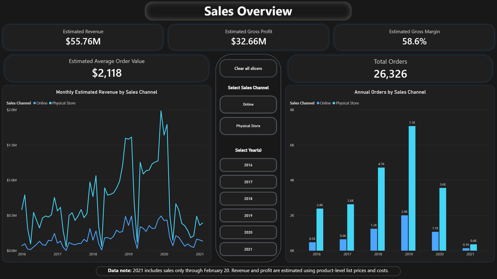
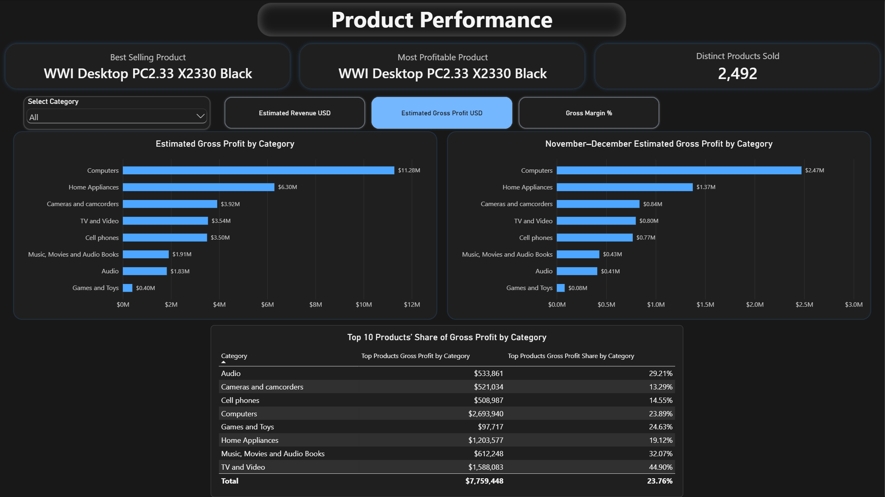
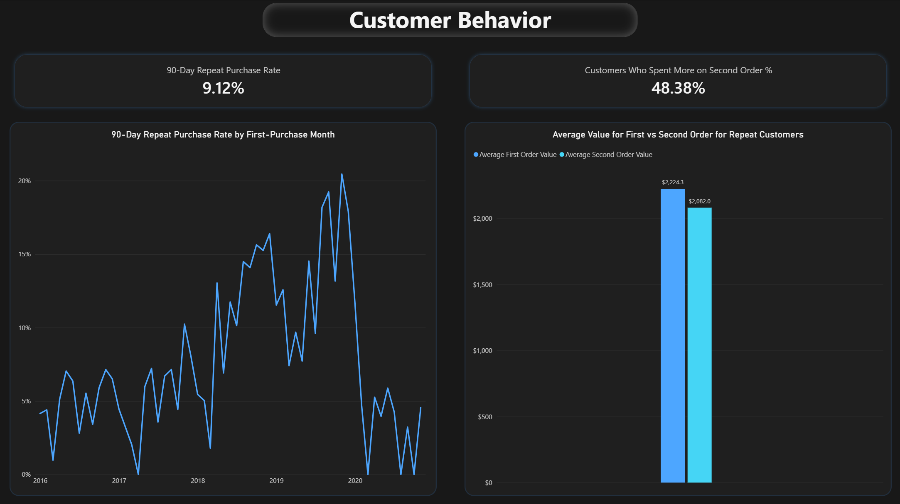
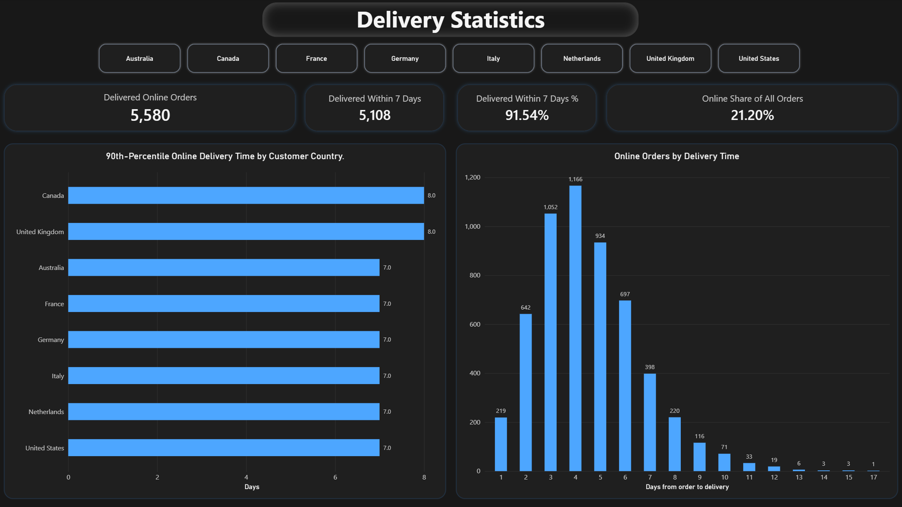
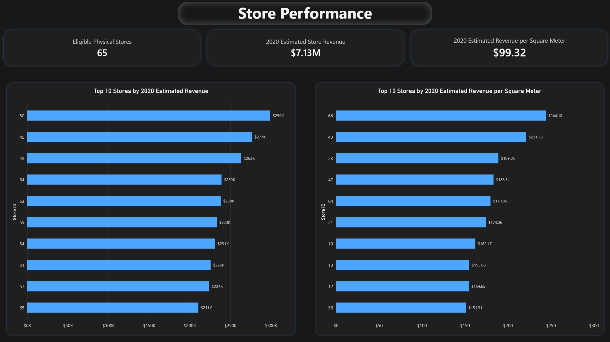

# Global Electronics Retailer Analysis | SQL + Power BI

## Introduction

This independent portfolio project uses PostgreSQL and Power BI to analyze a fictional global electronics retailer. The five report pages cover sales across online and physical stores, product profitability, customer repeat purchases, online delivery times, and store productivity.

The [Maven Analytics dataset](https://mavenanalytics.io/data-playground/global-electronics-retailer) covers January 1, 2016 through February 20, 2021. Revenue and gross profit are estimated from product list prices and costs. The Store Performance page uses 2020, the latest complete calendar year in the dataset.

The goal of this project was to combine the skills I've gained from my previous 2 projects on SQL and Power BI into one project that answers the following business questions:

### Business Questions

1. How are sales trending by sales channel?
2. Which categories drive the most profit?
3. What share of eligible customers purchase again within 90 days?
4. Among customers with two recorded order values, what share spent more on their second order?
5. How reliable is online delivery by country?
6. Which stores were most productive in 2020?

[View the Power BI report screenshots](#power-bi-report)

## Dataset Overview

The original files are in `csv_files/original_data/`.

Sales cover **January 1, 2016 to February 20, 2021**: **26,326 orders**, **62,884 sales lines**, and **197,757 units**. Orders by year were 2,865 in 2016, 3,280 in 2017, 5,965 in 2018, 9,083 in 2019, 4,635 in 2020, and 498 in 2021 (partial year).

| File | Rows | What it contains |
| --- | --- | --- |
| `Sales.csv` | 62,884 | One row per order line: Order Number, Line Item, Order Date, Delivery Date, CustomerKey, StoreKey, ProductKey, Quantity, Currency Code |
| `Customers.csv` | 15,266 | One row per customer: Gender, Name, City, State, Zip Code, Country, Continent, Birthday |
| `Products.csv` | 2,517 | One row per product: Product Name, Brand, Color, Unit Cost USD, Unit Price USD, Subcategory, Category |
| `Stores.csv` | 67 | One row per store: Country, State, Square Meters, Open Date |
| `Exchange_Rates.csv` | 11,215 | Daily exchange rates vs USD for 5 currencies, January 1, 2015 to February 20, 2021 |
| `Data_Dictionary.csv` | 37 | Field descriptions for the 5 tables above |

### Key notes

- **Sales channels:** `StoreKey = 0` is online. The other 66 stores in `Stores.csv` are physical stores, in 8 countries. `StoreKey 0` is listed in `Stores.csv` as Country `Online`, with no square meters.
- **Delivery Date is online-only:** It is populated for all 13,165 online sales lines (5,580 online orders) and blank for all 49,719 physical-store lines.
- **Not every customer purchased:** Only 11,887 of the 15,266 customers appear in `Sales.csv`.
- **Not every product was sold:** Only 2,492 of the 2,517 products were sold.
- **Not every store made a sale:** Nine physical stores (StoreKeys 3, 7, 11, 25, 35, 46, 52, 58, 60) never appear in `Sales.csv`.
- **Customers:** Customer base is located in 8 countries:
    - United States (6,828)
    - United Kingdom (1,944)
    - Canada (1,553)
    - Germany (1,473)
    - Australia (1,420)
    - Netherlands (733)
    - France (670)
    - Italy (645)
- **Products:** There are 11 brands, 32 subcategories within these 8 different categories:
    - Home Appliances (661)
    - Computers (606)
    - Cameras and camcorders (372)
    - Cell phones (285)
    - TV and Video (222)
    - Games and Toys (166)
    - Audio (115)
    - Music, Movies and Audio Books (90)
- **Currencies:** Sales use 5 currencies — USD (33,767 lines), EUR (12,621), GBP (8,140), CAD (5,415), and AUD (2,941). `Exchange_Rates.csv` has 2,243 dates x 5 currencies.
- **Estimated revenue and profit:** Revenue and gross profit are estimated from `Unit Price USD` and `Unit Cost USD` in `Products.csv`, not from recorded transaction amounts.


## Data Pipeline & Repository Structure

| Stage | Folder / File | What it does |
| --- | --- | --- |
| Source data | `csv_files/original_data/` | 6 source CSVs, including `Data_Dictionary.csv` |
| Setup | `sql/01_database/` | 4 scripts — create and verify the `global_electronics` database and schemas |
| Raw | `sql/02_raw_tables/` | 2 scripts — load the original CSVs into PostgreSQL raw tables |
| Core | `sql/03_core_tables/` | 8 scripts — clean values, assign data types, and define primary and foreign keys for Customers, Products, Stores, Exchange Rates, and Sales |
| Reporting | `sql/04_reporting/` | 10 scripts — shape sales lines, orders, calendar dates, cohorts, deliveries, and store performance into 7 reporting views, with 3 validation scripts |
| Analysis | `sql/05_Investigations/` | 9 scripts — exploratory queries behind the Key Findings, including the performance index |
| Visualization | `power_bi/Global_Electronics_Dashboard.pbix` | Imports the reporting views and supporting tables, then uses model relationships and DAX measures to build the 5-page report |

Run `sql/01` to `sql/04` in order to rebuild the database. `05_Investigations` is not required to rebuild it. However, running this optimization index query: [05_create_performance_index.sql](sql/05_Investigations/05_create_performance_index.sql) is recommended as it lowered the execution time from ~42 seconds to ~65 ms in my local test for one of our future investigations.

The `images/` folder holds the 5 dashboard screenshots used in this README.


## Reproduce the Project

### Rebuild PostgreSQL

Run the scripts from the repository root with PostgreSQL and the `psql` client available. Keep the original CSVs in `csv_files/original_data/` so the relative `\copy` paths resolve.

I wrote and ran most of the SQL in VS Code against a local PostgreSQL database. The reproduction steps use `psql` for the CSV imports because the load script contains `\copy` commands.


1. Run the database creation script in [`sql/01_database/`](sql/01_database/) from an existing database, such as `postgres`. Connect to the new `global_electronics` database and create the schemas there.
2. Run [`02_create_load_tables.sql`](sql/02_raw_tables/02_create_load_tables.sql) in `psql` to create and load the raw tables, then run [`02_verify_tables.sql`](sql/02_raw_tables/02_verify_tables.sql).
3. Build the cleaned tables with the scripts in [`sql/03_core_tables/`](sql/03_core_tables/). Create Customers, Products, Stores, and Exchange Rates before Sales so its foreign keys can resolve.
4. Create the reporting views in the order below. Run each linked validation script after its corresponding view is created.

| Order | Create script | View | Validation script |
| --- | --- | --- | --- |
| 1 | [04_create_sales_line.sql](sql/04_reporting/04_create_sales_line.sql) | `reporting.sales_line` | [04_verify_sales_line.sql](sql/04_reporting/04_verify_sales_line.sql) |
| 2 | [04_create_order_summary.sql](sql/04_reporting/04_create_order_summary.sql) | `reporting.order_summary` | [04_verify_order_summary.sql](sql/04_reporting/04_verify_order_summary.sql) |
| 3 | [04_create_date_dimension.sql](sql/04_reporting/04_create_date_dimension.sql) | `reporting.date_dimension` | [04_verify_date_dimension.sql](sql/04_reporting/04_verify_date_dimension.sql) |
| 4 | [04_create_repeat_purchase_cohorts.sql](sql/04_reporting/04_create_repeat_purchase_cohorts.sql) | `reporting.repeat_purchase_cohorts` | — |
| 5 | [04_create_first_second_order_summary.sql](sql/04_reporting/04_create_first_second_order_summary.sql) | `reporting.first_two_orders` | — |
| 6 | [04_create_90th_percentile_delivery_time_by_country.sql](sql/04_reporting/04_create_90th_percentile_delivery_time_by_country.sql) | `reporting.p90_delivery_days` | — |
| 7 | [04_create_store_performance.sql](sql/04_reporting/04_create_store_performance.sql) | `reporting.store_performance` | — |


### Open and Refresh the Power BI Report

1. After rebuilding PostgreSQL, open [`Global_Electronics_Dashboard.pbix`](power_bi/Global_Electronics_Dashboard.pbix) in Power BI Desktop.
2. Go to **File > Options and settings > Data source settings**. Select the PostgreSQL connection and use **Change Source** to enter your server and database. If those fields are unavailable there, update the PostgreSQL **Source** step in Power Query and select **Close & Apply**.
3. Enter your PostgreSQL credentials when prompted, then select **Home > Refresh**. With the report slicers cleared, Sales Overview should show about **$55.76M estimated revenue** and **26.3K orders** (26,326 in SQL).

To import the source tables into a blank report, use **Get data > PostgreSQL database** in **Import** mode. Load the seven reporting views listed above and the `core.customers`, `core.products`, and `core.stores` tables.

### Reporting Views

- **`sales_line`**. One row per order line with estimated revenue, cost, and gross profit.
- **`order_summary`**. One row per order with sales and delivery metrics.
- **`date_dimension`**. One row per calendar date for time-based analysis.
- **`repeat_purchase_cohorts`**. One row per first-purchase month with eligible customer counts and 90-day repeat purchase rates.
- **`first_two_orders`**. One row per customer with known values for both their first and second orders.
- **`p90_delivery_days`**. 90th-percentile delivery time by customer country for delivered online orders.
- **`store_performance`**. 2020 estimated revenue and revenue per square meter for eligible physical stores.

## Selected SQL Examples

### 90-Day Repeat Purchase Cohorts

The cohort view groups customers by first-purchase month and includes only those with a full 90-day observation window. In this excerpt, `c` is the customer’s first-purchase record. The correlated `EXISTS` flags a purchase made on a later date within 90 days. [04_create_repeat_purchase_cohorts.sql](sql/04_reporting/04_create_repeat_purchase_cohorts.sql)

```sql
WITH customer_first_order AS(
    SELECT
        customer_key,
        MIN(order_date) AS first_purchase
    FROM
        reporting.order_summary
    GROUP BY
        customer_key
),

eligible_customers AS(
    SELECT
        customer_key,
        first_purchase,
        DATE_TRUNC('month', first_purchase)::DATE AS cohort_month,
        EXISTS(
            SELECT 1
            FROM core.sales AS s
            WHERE
                s.customer_key = c.customer_key AND
                s.order_date > c.first_purchase AND
                s.order_date <= (c.first_purchase + INTERVAL '90 days')
        ) AS returned_within_90_days_check
    FROM
        customer_first_order AS c
    WHERE
        (c.first_purchase + INTERVAL '90 days') <= (SELECT MAX(order_date) FROM reporting.order_summary)
)

SELECT
    cohort_month,
    COUNT(*) AS eligible_customer_count,
    COUNT(*) FILTER(WHERE(returned_within_90_days_check = TRUE)) AS returned_within_90_days_count,
    ROUND(
        (COUNT(*) FILTER(WHERE(returned_within_90_days_check = TRUE))::NUMERIC
        / NULLIF(COUNT(*) ,0)), 4) AS returned_within_90_days_rate
FROM
    eligible_customers
GROUP BY
    cohort_month
ORDER BY
    cohort_month;
```

### SQL Query Performance Optimization

During the 90-day repeat purchase analysis, I identified a performance bottleneck using PostgreSQL's `EXPLAIN (ANALYZE, BUFFERS)`.

The query performed repeated sequential scans of the Sales table while checking whether customers made another purchase within 90 days of their first order.

I created a composite B-tree index on `customer_key` and `order_date`, allowing PostgreSQL to perform efficient index-only lookups instead of repeatedly scanning the entire table.

```sql
CREATE INDEX IF NOT EXISTS idx_sales_customer_order_date
ON core.sales (customer_key, order_date);
```

**Results:**
- Before optimization: 42,117 ms
- After optimization: 65.7 ms
- Execution time reduced by approximately 99.84%
- Query ran approximately 641 times faster

The optimization preserved the original analytical logic while substantially improving query execution performance.

### Order Summary Validation

This check verifies that the order summary has one row per order and provides totals to compare with the sales-line view. It returned **26,326 orders** and **zero extra rows**. The two reporting views agreed on sales lines, units, estimated revenue, cost of goods sold, and gross profit. [04_verify_order_summary.sql](sql/04_reporting/04_verify_order_summary.sql)

```sql
SELECT
    COUNT(*) AS order_rows,
    COUNT(*) - COUNT(DISTINCT order_number) AS extra_rows_per_order,
    SUM(line_count) AS sales_lines,
    SUM(units) AS units,
    COUNT(*) FILTER (WHERE store_key = 0) AS online_orders,
    MIN(delivery_days) AS min_delivery_days,
    MAX(delivery_days) AS max_delivery_days,
    SUM(estimated_revenue_usd) AS estimated_revenue_usd,
    SUM(estimated_cogs_usd) AS estimated_cogs_usd,
    SUM(estimated_gross_profit_usd) AS estimated_gross_profit_usd
FROM
    reporting.order_summary;
```

The sales-line check found **62,884 rows** in both `core.sales` and `reporting.sales_line`. The reporting view totaled **197,757 units**, **$55.76M estimated revenue**, and **$32.66M estimated gross profit**. [04_verify_sales_line.sql](sql/04_reporting/04_verify_sales_line.sql)

## Power BI Report

### Sales Overview
Tracks estimated revenue, gross profit, margin, and order volume across online and physical stores. The dataset includes sales through February 20, 2021. Users can interact with this dashboard to select desired year and/or sales channel.



### Product Performance
Compares full-period and holiday-season performance by category. Users can filter by category and also choose to view revenue, gross profit, or margin for each category.



### Customer Behavior
The 90-day repeat purchase rate was 9.12% among 11,745 eligible customers. Among the 7,272 customers with values for both orders, the second order averaged $142.25 less, though 48.38% spent more.



### Delivery Statistics
Of 5,580 delivered online orders, 91.54% arrived within seven days. The 90th-percentile delivery time was eight days in Canada and the United Kingdom and seven days in the other six countries. Users can filter down to a specific country.



### Store Performance
The 65 eligible physical stores generated $7.13M in estimated 2020 revenue. Store 50 led in total revenue at about $299K, while Store 66 led in revenue per square meter at $244.18.




## Key Findings

- **Sales:**
    - Physical-store orders fell from 7,077 in 2019 to 3,564 in 2020 while AOV stayed near $2,028.
    - Estimated Revenue: $55.76M
    - Gross Profit: $32.66M
    - Margin: 58.6%
    - 2019 led in orders (9,083) and estimated revenue ($18.26M).
    - Average Order Value: $2,118
    - Number of Orders: 26.3K
    - Physical stores dominate online.
- **Products**:
    - Computers lead by far at $11.28M gross profit, then Home Appliances at $6.30M.
    - Profit is concentrated — the top 10 products are 44.90% of TV and Video gross profit.
- **Customers**:
    - Only 9.12% repeat within 90 days,
    - Among the 7,272 customers with 2 recorded orders, 48.38% spent more on their second order.
    - Average first order $2,224.29 vs. $2,082.04 for second order, $142.25 difference.
- **Delivery:**
    - 5,580 delivered online orders, 91.54% within 7 days.
    - 90th-percentile is 7 days in six countries, 8 days in Canada and the UK.
    - Four days was the most common delivery time (1,166 orders), with the maximum being 17 days.
- **Stores:**
    - 65 eligible stores made $7.13M in 2020.
    - Store 50 led on total revenue at $299K, but Store 66 led on efficiency at $244.18 per square meter vs. $99.32 overall — biggest isn't always most productive.

## Definitions, Assumptions & Limitations

- Revenue/profit are estimated from list prices and costs.
- 2021 data is only through Feb 20.
- Delivery is delivered online orders only.
- Repeat rate is eligible customers with a full 90-day window only.
- Store Performance is 2020 eligible stores only. Eligibility refers to physical stores with positive floor area that opened on or before January 1, 2019. Of the 65 eligible stores, 51 had recorded revenue in 2020.
- The overall revenue-per-square-meter benchmark ($99.32/square meter) is calculated using the combined revenue and floor area of those 51 stores, excluding eligible stores without recorded revenue.
- Monthly sales analysis revealed recurring sharp revenue declines in April from 2016 through 2020. Physical-store orders were recorded on only 4–7 distinct days during April each year, suggesting potentially uneven transaction coverage. Without additional source documentation, these declines cannot confidently be attributed to normal seasonal demand.

## Conclusion

Overall, the analysis revealed a business heavily reliant on physical-store sales, with gross profit concentrated in certain product categories, generally consistent delivery performance, and a relatively low 90-day repeat purchase rate.

Sales peaked in 2019 before declining in 2020, primarily due to a significant reduction in physical-store order volume rather than average order value. Only 9.12% of eligible customers made another purchase within 90 days, highlighting an opportunity to investigate customer retention. Product profitability varied across categories, while store rankings differed depending on whether performance was measured by total revenue or revenue per square meter.

These findings highlight several areas worth investigating further, including the factors behind declining sales, opportunities to encourage repeat purchases, and differences in product and store performance. Together, they provide a foundation for more targeted business decisions and future analysis.

## Recommendations

- **Test a first-time buyer follow-up campaign.** With a historical 90-day repeat purchase rate of 9.12% among eligible customers, test a targeted follow-up offer for first-time buyers. Divide customers into a treatment group receiving the offer and a control group receiving no additional outreach. Compare their 90-day repeat purchase rates to evaluate the campaign's effectiveness, using the historical 9.12% rate as a baseline.
- **Protect the profit drivers.** Computers ($11.28M gross profit) and Home Appliances ($6.30M) carry the result, so monitor their availability, pricing, and assortment closely — and look into why TV and Video profit is so concentrated in its top 10 products.
- **Chase the delivery long tail.** Overall delivery is reliable at 91.54% within seven days, but some orders took up to 17 days, and Canada and the UK sit at an eight-day 90th percentile. Investigate those outliers by country and carrier before promising faster delivery.
- **Learn from Store 66, not just Store 50.** Judge stores on revenue per square meter as well as total revenue, and study what Store 66 does differently at $244.18 per square meter versus $99.32 overall.
- **Do not treat the April declines as seasonality yet.** April revenue fell in 2016–2020, but physical-store orders were recorded on only 4–7 days each April, so confirm the transaction coverage with the source owner before acting on it.